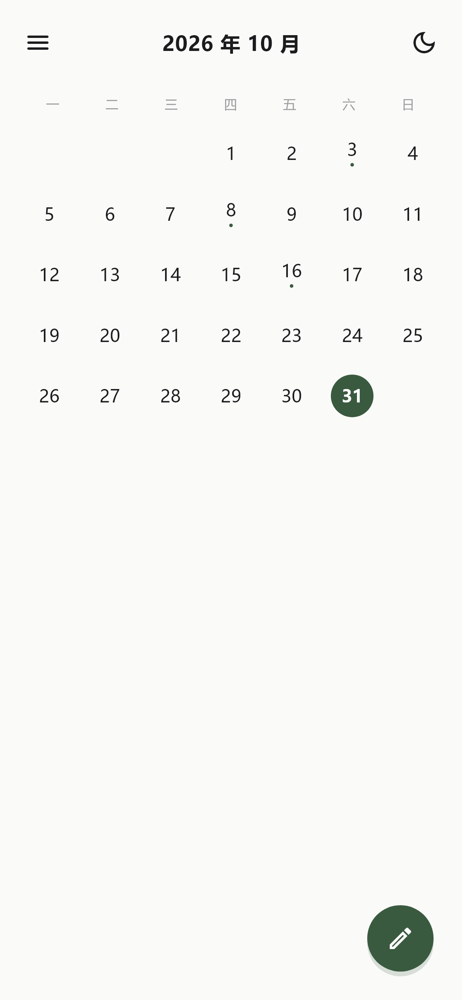
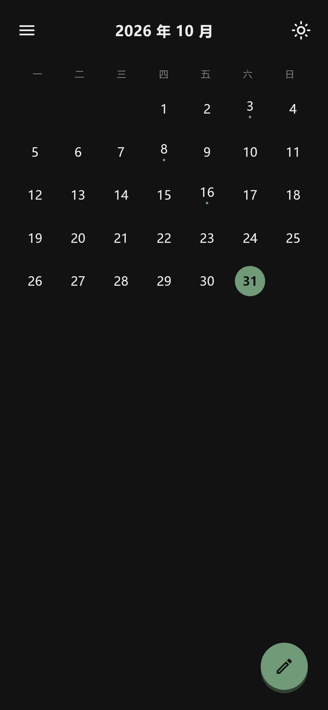
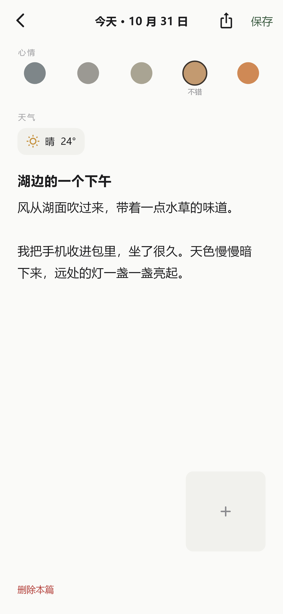
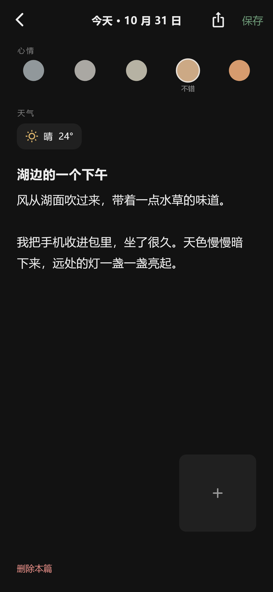

# 一日

> 每天翻一页诗，在日历上点一笔。  
> 一个完全本地的极简日记 App，Flutter · iOS 15+ · Android 8.0+。

所有日记、图片、草稿都在手机本地。只有「获取天气」和「在线换一首诗」会发起匿名 HTTPS GET；没有账号、没有后端、没有付费 Key、没有云同步。

## 已生成 APK

本次已实际构建 release APK，并安装到 Android 14（x86_64）模拟器验证启动。

- 文件：[一日-release.apk](一日-release.apk)
- 大小：65,144,802 字节（约 62.1 MiB）
- SHA-256：`2A7789B71ED9ECDF08B2B9B73F680DAD9F9E687AD171673EB963634704F2F528`
- 本版：三 Tab、3/5 屏月历、年月切换弹窗、阴历、过去选中日期卡片、阅读详情页、收藏横卡与回到顶部、月历随页滚动、编辑页日期放大、应用内相机、导入导出、纯黑主题。
- 签名：当前 `android/app/build.gradle.kts` 的 release 使用 debug signing，可直接安装自用；上架 Google Play 前需要换成正式 keystore。
- 架构：通用 APK，包含 arm64-v8a / armeabi-v7a / x86_64。
- 应用图标：手写「一日」，源图在 `design/app_icon_source.jpg`；iOS 与 Android 各尺寸图标由 `design/make_icons.py` 生成。

## 界面预览

| 开屏 | 日历 · 浅色 | 日历 · 深色 |
| --- | --- | --- |
|  |  |  |

| 编辑 · 浅色 | 编辑 · 深色 |
| --- | --- |
|  |  |

> 预览图由 Flutter widget test 以 390×844 逻辑尺寸渲染；测试中的两张图片是透明占位图，所以编辑页图片格里只看得见「+」。真机上会显示实际照片。

## 运行

### 环境

本项目在 **Flutter 3.47.9 / Dart 3.13.7** 下执行过 `flutter pub get`、`flutter analyze` 与 `flutter test`。

- iOS 15.0+（Xcode 15+）
- Android 8.0（API 26）+
- 当前最新稳定依赖中 `share_plus 13.3.1` 要求 Flutter ≥ 3.38.1；因此实际最低 Flutter 版本以依赖解析结果为准，高于任务书的 3.22 基线。若要严格回到 Flutter 3.22，需要把 `share_plus`、`file_picker` 等依赖降级，会违背「依赖使用最新稳定版」的要求。
- `geolocator` 固定为 `14.0.1`：`14.1.x` 的 `geolocator_linux` 与 `connectivity_plus 7.3.2` 的 `dbus` 约束冲突；移动端功能不受影响。

### 本机实际构建记录

- Android Studio Rabbit 2（2026.2.2）
- Android SDK：`D:\sdsdk`
- JDK：`D:\ad\jbr`
- 目标设备：Android 14（API 34）x86_64 模拟器
- 构建时由于 Gradle 9.3 对中文真实路径兼容性不佳，使用 ASCII 目录副本构建；交付源码不受影响
- 为适配中国网络，Gradle wrapper 使用腾讯云镜像，Maven 仓库前置了阿里云镜像
- 构建命令：`gradlew.bat assembleRelease`

### 启动

```bash
cd yiri
flutter pub get
flutter run
```

iOS 首次构建：

```bash
cd ios
pod install
cd ..
flutter run
```

Android 需要本机安装 Android SDK、JDK 17+ 并接受 license：

```bash
flutter doctor --android-licenses
flutter run
```

只打 APK：

```bash
flutter build apk --release
# 输出 build/app/outputs/flutter-apk/app-release.apk
```

当前 release 构建沿用 demo 配置的 debug 签名，可直接安装；正式发布前请改成自己的 keystore。

### 代码生成

Drift 生成的 `lib/data/database/app_database.g.dart` 已提交。修改表结构后重新生成：

```bash
dart run build_runner build --force-jit
```

### 测试

```bash
flutter analyze
flutter test
```

本机测试结果（本次交付）：

```text
flutter analyze  -> No issues found!
flutter test     -> 20 tests passed
```

测试覆盖：

- 内置诗词不少于 60 首、日期哈希稳定、诗词换行；
- 日历月首/星期一起始/今天与未来判断；
- 心情、天气枚举与 WMO 映射；
- Drift 仓库「一天一篇」、导入跳过/覆盖；
- manifest 编解码、Markdown front-matter、不安全路径拒绝；
- 真实 zip 打包/解包 isolate 往返，检查 `manifest.json + entries/ + images/` 结构与图片原始字节；
- 开屏无 loading、日历空状态、深色主题可读性（widget 截图）；
- 主题偏好读取与手动切换写回。

Windows 上若要运行依赖原生 SQLite 的仓库测试，需要 `sqlite3.dll` 在 `PATH` 中；缺失时该组测试会自动 skip，不影响其余测试。Android/iOS 构建会由 `sqlite3` 的 native assets 打包自带库。

---

## 目录

```text
yiri/
├─ assets/poetry.json                       # 85 首公版唐诗宋词
├─ docs/                                    # README 预览图
├─ lib/
│  ├─ main.dart                             # runApp 前读主题、200ms 网络探测、诗词预加载
│  ├─ app.dart                              # MaterialApp.router + 全局 RepaintBoundary
│  ├─ core/
│  │  ├─ app_colors.dart                    # 浅/深色主题色板扩展
│  │  ├─ app_theme.dart                     # Material 3 主题、状态栏样式
│  │  ├─ app_keys.dart                      # root navigator / root RepaintBoundary Key
│  │  ├─ date_utils.dart                    # 日期只保留年月日、周一起始
│  │  └─ widgets.dart                       # 顶栏图标、淡入位移、SnackBar
│  ├─ models/
│  │  ├─ diary_entry.dart                   # DiaryEntry
│  │  ├─ mood.dart                          # 五档心情与颜色值
│  │  ├─ weather_code.dart                  # 七种天气 + WMO 映射
│  │  └─ poem.dart                          # Poem / PoetryLibrary / 日期哈希选择器
│  ├─ data/
│  │  ├─ database/
│  │  │  ├─ app_database.dart               # Drift 表、唯一日期索引、非破坏 migration
│  │  │  ├─ app_database.g.dart             # Drift 生成代码
│  │  │  └─ diary_repository.dart           # 一天一篇、导入覆盖、Stream
│  │  ├─ images/app_image_storage.dart      # 私有图片目录 + isolate JPEG 压缩
│  │  ├─ poetry/
│  │  │  ├─ poetry_library.dart             # 内置诗词加载
│  │  │  ├─ poetry_cache_store.dart         # 当天在线诗缓存（文件，不占偏好）
│  │  │  ├─ poetry_remote_source.dart       # PoetryRemoteSource + 两个默认源
│  │  │  └─ poetry_service.dart             # 1.5s 超时、源回退、缓存
│  │  ├─ preferences/
│  │  │  ├─ preferences.dart                # shared_preferences 只存 theme_mode
│  │  │  └─ draft_store.dart                # 草稿 JSON 文件（2s 防抖 / 后台即存）
│  │  ├─ weather/weather_service.dart       # 已授权才定位 + Open-Meteo
│  │  └─ startup_state.dart                 # 启动网络/诗词/缓存状态
│  ├─ features/
│  │  ├─ splash/splash_page.dart            # 本地诗 0 等待、在线替换、上滑/点击退场
│  │  ├─ calendar/
│  │  │  ├─ calendar_page.dart              # 月网格、切月、菜单、空状态、FAB
│  │  │  └─ month_picker_sheet.dart         # 月份选择器
│  │  ├─ editor/
│  │  │  ├─ editor_page.dart                # 心情/天气/正文/图片/草稿/保存/删除
│  │  │  └─ widgets/
│  │  │     ├─ mood_selector.dart
│  │  │     ├─ weather_picker.dart
│  │  │     └─ image_preview.dart
│  │  ├─ backup/
│  │  │  ├─ backup_models.dart              # manifest / scope / 结果模型
│  │  │  ├─ backup_codec.dart               # manifest 校验 + Markdown 生成
│  │  │  ├─ backup_worker.dart              # isolate 内 zip 打包/解包
│  │  │  ├─ backup_service.dart             # 进度、isolate 编排、文件定位
│  │  │  ├─ progress_dialog.dart            # 百分比 + 切后台提示
│  │  │  ├─ export_flow.dart                # 全部/月份/单篇导出、分享、存文件夹
│  │  │  └─ import_flow.dart                # manifest 校验、跳过/覆盖、回导
│  │  └─ theme/
│  │     ├─ theme_controller.dart           # ThemeMode 持久化
│  │     └─ theme_reveal.dart               # 截图 + ClipPath 圆扩散（450ms）
│  └─ routing/app_router.dart               # go_router 路由与 250ms 淡入
├─ test/                                    # 20 个测试
├─ android/                                 # minSdk 26、权限、原生启动底色、图标
├─ ios/                                     # iOS 15、Podfile、权限、启动底色、图标
├─ pubspec.yaml
└─ README.md
```

## 数据模型

```dart
class DiaryEntry {
  String id;              // uuid
  DateTime date;          // 唯一键，仅年月日
  String? title;
  String content;
  Mood? mood;             // 5 档枚举
  String? weatherCode;    // sunny/cloudy/overcast/rain/snow/fog/wind
  int? temperature;       // 摄氏度
  List<String> images;    // 私有目录下的相对路径
  DateTime createdAt;
  DateTime updatedAt;
}
```

Drift 表 `diary_entries`：

- `date_key TEXT UNIQUE` 存 `yyyy-MM-dd`，并在 `onCreate` 再建唯一索引；
- `images` 存相对路径 JSON 数组，数据库不存绝对路径；
- `schemaVersion = 1`，`onUpgrade` 预留按版本顺序的 `ALTER TABLE` 位置，不清空用户数据。

## 页面跳转

```text
App 启动
  ├─ 无网络（或 200ms 超时） → /calendar?fade=1（直接淡入日历，不出现诗词页）
  └─ 有网络 → /（开屏诗词）
                 └─ 上滑 / 点击 → /calendar
/calendar
  ├─ 点过去/今天的日期 → /editor?date=yyyy-MM-dd（已有则编辑，没有则新建）
  ├─ 右下角笔 → /editor?date=今天
  └─ 左上角菜单 → bottom sheet
                    ├─ 导出全部
                    ├─ 按月份导出 → 月份选择器
                    └─ 导入备份 → 文件选择 → 冲突确认
```

图片预览使用淡入全屏 `showGeneralDialog`，不额外增加路由。

## 关键实现说明

### 开屏

- `main()` 在 `runApp` 前并发启动偏好、在线诗词库加载，并用 `connectivity_plus` 做 **200ms 硬超时**探测。
- 离线直接初始路由到日历，网络探测期间只显示与 App 背景同色的原生启动屏，不出现 loading。
- 在线时内置诗词已加载完成，Flutter 第一帧即可显示；`SplashPage` 在首帧后请求在线源，总超时 **1.5s**，成功则整首诗 `AnimatedSwitcher` 淡出淡入并写入当天缓存，失败静默保留。
- 当天若已有缓存，使用缓存避免同一天多次启动换诗。
- 上滑超过 60px 或速度超过 350px/s，内容上移 34px 淡出 250ms，再进入日历。

### 主题与圆扩散

- `ThemeMode` 三态在 `main()` 前解析；首次为 `system`，手动点过一次后只写 `light`/`dark`，不再跟随系统。
- `shared_preferences` **只保存** `theme_mode`；草稿和诗词缓存都是私有目录文件。
- 日历右上角按钮是唯一的主题切换入口：
  1. `rootBoundaryKey` 的 `RepaintBoundary.toImage(pixelRatio: devicePixelRatio)` 抓当前帧；
  2. 截图放入 `Overlay` 全屏、`IgnorePointer` 盖住；
  3. 立即切换主题，`themeAnimationDuration = 0`；
  4. `ClipPath` + `CustomClipper<Path>` 使用 `Path.combine(PathOperation.difference, 全屏矩形, 圆)`，圆心来自按钮 `RenderBox` 全局中心，半径从 0 到最远角 +20；
  5. 450ms / `Curves.easeOutCubic`，结束后移除 overlay 并 dispose 图片。
- 动画期间同一控制器只允许一次；截图失败退化为 200ms 淡入淡出。

### 图片

- `image_picker` 选择相册/拍照，最多 9 张。
- `flutter_image_compress` 统一转 JPEG 85%，长边上限 2000px；小于 2000px 不放大。
- 压缩优先在 `Isolate.run` 内调用原生压缩，使用 `BackgroundIsolateBinaryMessenger`；若后台 isolate 不支持该插件，则回退到原生线程的异步压缩，主线程不阻塞。
- 只把压缩后的图片写入 `Documents/images/`，数据库只记录 `images/xxx.jpg` 相对路径，不保留原图。
- 添加时显示转圈；全屏预览长按二次确认删除。

### 导出格式

固定 zip 结构：

```text
manifest.json
entries/2025-06-12.md
images/<日记id>_1.jpg
images/<日记id>_2.png
```

`manifest.json` 示例：

```json
{
  "app": "一日",
  "format": "yiri-diary-backup",
  "version": 1,
  "exportedAt": "2025-06-12T21:04:00.000",
  "entries": [
    {
      "id": "6f1c...",
      "date": "2025-06-12",
      "title": "湖边",
      "content": "今天的风很轻。",
      "mood": 4,
      "weatherCode": "sunny",
      "temperature": 26,
      "images": ["6f1c..._1.jpg"],
      "createdAt": "2025-06-12T20:00:00.000",
      "updatedAt": "2025-06-12T21:00:00.000"
    }
  ]
}
```

Markdown 示例：

```markdown
---
date: 2025-06-12
mood: 4
weather: sunny
temperature: 26
---

# 湖边

今天的风很轻。


```

- 回导只认 manifest；缺文件/版本不匹配会拒绝并给出可读原因。
- 图片文件缺失时导出照常进行，结果报告缺失数量；Markdown 只引用实际打包的图片。
- 打包与解包在 `Isolate.spawn` 中完成，主线程只接收百分比。`manifest.json` 用 `ZipFileEncoder.addArchiveFile`，图片用流式 `addFile`，避免一次性把全部图片读进内存。
- 导入在后台解包并写图片，Drift 数据库本身通过 `NativeDatabase.createInBackground` 在后台 isolate 执行，避免主线程写库。
- 冲突：默认「跳过已存在」；选择「覆盖重写」时按日期替换整篇，保留 manifest 的 id、时间、心情、天气、温度、图片。
- 超过 200MB 会先提示连接充电器，但允许继续；进度对话框在 App 切后台时显示明确提示。

### 在线诗词源替换

接口在 `lib/data/poetry/poetry_remote_source.dart`：

```dart
abstract interface class PoetryRemoteSource {
  String get url;
  Future<Poem?> fetch(Dio dio);
}
```

默认实现：

1. `JinrishiciSource` — `https://v1.jinrishici.com/all.json`
2. `HitokotoPoetrySource` — `https://v1.hitokoto.cn/?c=i&encode=json&charset=utf-8`

替换方式：新建一个实现类（一个 URL 常量 + 一个 JSON 解析器），然后在 `lib/data/poetry/poetry_service.dart` 的 `sources` 中调整顺序/替换即可。任何一个源失败都会尝试下一个，整体 1.5s 超时，任何失败都不会阻塞写日记。

## 验收自检

勾选口径：`[x] 实现` 表示代码与对应自动化测试/预览已完成；`[x] Android 14` 表示已在 Android 14 x86_64 模拟器安装 release APK 并实际操作验证；`[ ]` 表示受环境限制尚未验证。

已实际验证：release APK 安装启动、离线直接进入日历、空状态、今天高亮、新建并保存正文/心情、再次打开回显、强制停止重开数据仍在、深色日历/编辑页/底部菜单、左上角菜单三项展示、横屏布局无溢出。

| # | 验收项 | 实现 | Android 14 模拟器 | 说明 |
| --- | --- | --- | --- | --- |
| 1 | 断网冷启动直接日历、无白屏/loading | [x] | [x] | release 版冷启动直接进入日历，无诗词页、无 loading |
| 2 | 联网诗词 100ms 可见、1.5s 内替换 | [x] | [ ] | 模拟器网络无法访问在线源；本地诗词与超时逻辑由单测覆盖 |
| 3 | 上滑/点击进入日历，动画流畅 | [x] | [ ] | 点击进入逻辑已实现；开屏上滑与帧率未手动操作 |
| 4 | 今天高亮、左右切月、跨月不高亮 | [x] | [x] | 31 日主色实心圆已验证；切月为 PageView |
| 5 | 笔 → 新建今天；填心情/天气/正文/2 图保存 | [x] | [ ] | 已实机保存标题、正文、心情；图片/相机/天气未实机验证 |
| 6 | 再次打开是同一篇、字段回显 | [x] | [x] | 点 31 日再次进入，标题/正文/心情完整回显 |
| 7 | 杀进程重开仍在 | [x] | [x] | `am force-stop` 后重开，日记与主题均保留 |
| 8 | 无定位权限可手动选天气 | [x] | [x] | 编辑页显示「选择天气」入口；天气选择面板未实机点击 |
| 9 | 深色模式所有页面可读 | [x] | [x] | 深色日历、编辑页、底部菜单已实机截图确认 |
| 10 | analyze 零 error；iOS/Android 模拟器启动 | [x] 分析 | [x] Android / [ ] iOS | `No issues found!`；Android release APK 已安装运行；无 macOS/Xcode，iOS 未验证 |
| 11 | 单篇导出 zip 结构、Markdown 相对图片可用 | [x] | [ ] | 真实 zip 打包/解包测试覆盖结构与图片字节 |
| 12 | 导出全部、删除重装、导入字段一致 | [x] | [ ] | 仓库与 zip 测试覆盖；未执行系统级卸载重装导入 |
| 13 | 二次导入：跳过不重复、覆盖替换 | [x] | [ ] | `repository_test` 覆盖两种模式 |
| 14 | 导出进度、不卡顿、切后台有提示 | [x] | [ ] | isolate + ValueNotifier + 后台提示 |
| 15 | 主题按钮圆扩散 450ms，双向 | [x] | [x] 点击 / [ ] 动画 | 主题切换成功且持久化；圆扩散中间帧未录屏 |
| 16 | 动画期间连点不叠加 | [x] | [ ] | `_busy` 守卫 + IgnorePointer |
| 17 | 手动深色持久化，系统切浅色不影响 | [x] | [x] | 深色后强杀重开仍为深色；系统切换未验证 |
| 18 | 深色逐页检查对比度 | [x] | [x] | 日历/编辑页/底部菜单实机确认 |
| 19 | 左上角菜单三项均可进入流程 | [x] | [x] | 菜单底部面板三项已实机展示；导出/导入弹窗未完整走完 |

### 验证环境与未验证项

已在本机 Windows 11 + Android 14 x86_64 模拟器完成 Android release 安装与核心交互验证。

仍受环境限制、未端到端验证的项目：

- iOS 15 模拟器（需要 macOS + Xcode）；
- 联网开屏诗词替换（模拟器无法访问在线源）；
- 相机、相册、定位、系统分享面板、导出/导入的选择器弹窗；
- 圆扩散动画中间帧与长时导出/导入进度。

代码层面已通过 `flutter analyze` 零 issue 和 20 个自动化测试；导入导出 zip 与 Drift 数据规则在测试中真实读写验证。

## 开源与许可

- GitHub 仓库：https://github.com/Liuchang995/yiri
- 源码公开，采用仓库根目录的 [LICENSE](LICENSE)：《一日 · 非商业源码许可 1.0》。
- 允许个人学习、修改和非商业分发；**禁止任何商业使用**。
- 如需商业授权，请联系仓库所有者。
- 3 个架构的 APK 发布在 GitHub Releases，不提交进源码仓库。

## 隐私

- 无登录、无账号、无云端；
- 无任何数据上传，除了：
  - Open-Meteo 的匿名天气 GET（只发经纬度，不写日记内容）；
  - 今日诗词/一言的匿名诗词 GET；
- 分享与保存文件夹完全由用户主动触发，通过系统面板完成；
- 删除日记时同步删除对应图片文件。

## 范围外

未实现：通知提醒、全文搜索/心情筛选、密码锁、云同步/账号、多语言、字体大小设置、自定义配色、其他页面主题按钮、图片分享卡片、桌面小组件、Watch、从其他 App 导入、PDF 导出。

## 公版说明

`assets/poetry.json` 中诗词均为公版唐诗宋词/元曲，作者与篇名保留；在线源只用于替换展示，失败完全降级到本地库。
